# Joust

**A Hermes Agent plugin that races 2 to 4 coding subagents on the same task, each in its own Git worktree, judges them with your tests, and merges only the best patch after you approve.**

One `joust_launch` call gives every contender a detached Git worktree and its own Hermes subagent, optionally on its own model. A `tool_request` middleware keeps each child's file and terminal calls inside its worktree. Joust then runs your test command in every worktree, fires each contender's new tests at its rivals (Crossfire), and ranks them. Everything is measured by one question: **which patch passes the most tests, its own and its rivals', and runs fastest with the smallest diff?**

Built for the Hermes Agent Plugin Hackathon 2026 · Demo: `<VIDEO_URL>` · Code: [github.com/mrnetwork0001/Joust](https://github.com/mrnetwork0001/Joust) · Requires Hermes Agent >= 0.22.5 · Linux and macOS

**Judges, start here:** with Joust enabled, type `/joust demo` in any Hermes chat. It builds a throwaway repository, runs a full three-contender tournament with Flake Shield and Crossfire, and prints the leaderboard in about two seconds, with no model key and no repository of your own. Then open **Joust Arena** in the Hermes Desktop sidebar (`/joust`).

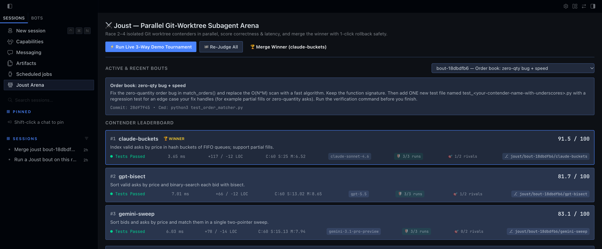

---

## One bout, four steps, no model key needed for the demo

| Step | What it is | Try it without a model key |
| --- | --- | --- |
| **Launch** | `joust_launch` validates 2 to 4 contenders, creates one detached worktree each under `<HERMES_HOME>/plugin-data/joust/worktrees/<bout>/<contender>`, mirrors your uncommitted tracked edits into each and commits them as the worktree baseline, then launches one subagent per contender through `ctx.subagent_lifecycle`. Each contender may name its own `model`. | `/joust demo` builds the bout with `spawn_subagents=False` and writes three real implementations into the worktrees itself. |
| **Judge** | `joust_evaluate` runs the bout's test command in every worktree through the Hermes `terminal` tool. Score out of 100: **Correctness 60** (all runs pass), **Speed 25** (fastest passing time divided by yours), **Minimal diff 15** (full marks up to 12 changed lines, then `15 / (1 + (lines - 12) / 90)`). A test can print `JOUST_BENCHMARK_MS=<float>` to replace wall-clock time. | The demo judges each contender with `runs=3`. |
| **Crossfire** | `joust_crossfire` copies each contender's new or changed test files into every rival worktree (renamed with a `__xfire_<contender>` suffix), runs them, and removes them. Survival rate is the **first** tiebreak, ahead of points. *A winner has to pass its rivals' tests, not only its own.* | In the demo, `hash-bucket-index` ships a partial-fill test that `bisect-sorted-book` fails. |
| **Merge** | `joust_merge` pre-flights the winner's patch with `git apply --check`, asks for your approval through Hermes's approval card, applies it, and saves a rollback patch. Every contender is kept as a `joust/<bout>/<contender>` branch first. `action="rollback"` undoes it. | `/joust merge <bout_id>` then `/joust rollback <bout_id>` on the demo bout. |

### More to explore

| Feature | What it is | Where |
| --- | --- | --- |
| **Flake Shield** | Runs the command 1 to 7 times (`runs`, config `default_runs`). Every run must pass, speed uses the median, and a mixed record marks the contender `flaky`, which can never win. | `joust_evaluate runs=3` |
| **Steer** | Sends guidance to a running contender (`ctx.subagent_lifecycle.steer`) or writes files into its worktree only. | `joust_steer` |
| **Diffs** | Unified diff and line counts per contender, binary-safe, build junk (`__pycache__`, `*.pyc`, `.pytest_cache`, `node_modules`) excluded. | `joust_diff` |
| **Bout report** | Markdown scoreboard, Flake Shield runs, Crossfire matrix, diffs, outputs and timeline, saved under `plugin-data/joust/reports/<bout>.md` or a path inside the repo. | `joust_report`, `/joust report <bout_id>` |
| **Auto-judge** | When a contender subagent finishes, Joust judges its worktree on a background thread (config `auto_evaluate_on_stop`). | `subagent_stop` hook |
| **Desktop arena** | A `/joust` page (leaderboard, diff viewer, test output, Run Demo), a right pane, a status-bar chip, the palette command **Joust: Open Parallel Worktree Arena**, and an inline `::joust-bout{id="..."}` card the agent can put in its reply. | Hermes Desktop |
| **CLI** | `hermes joust list`, `demo`, `merge <bout_id> [--contender ID] [--rollback]`. `judge <bout_id>` refuses and points you to `/joust judge`, because judging runs a model-chosen command. Wired when plugins run in-process, the Hermes default. | Terminal |

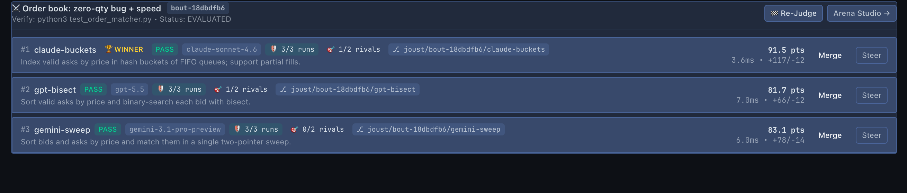

The bundled skill `joust:joust-arena` teaches the agent the whole workflow. The Desktop half polls the dashboard API every 4 seconds while visible, so it stays live even when plugins run in a separate plugin host. Its **Re-Judge** buttons hand the request to the agent in the chat composer instead of running commands from a click.

## Why plugin surfaces are essential

- **No middleware, no isolation.** Hermes rejects `working_directory` on subagent launches, so parallel children share one directory. Joust's `tool_request` middleware rewrites each child's `path`, V4A patch headers, `search_files` root and terminal `workdir` into its worktree, per child session (`rewrite_tool_args_for_worktree` in `worktree_engine.py`). A prompt cannot do this.
- **No lifecycle hooks, no binding.** The child's session id is only exposed by the `subagent_start` hook, which Hermes fires inside `launch()`. Joust embeds a `joust:bout=...;contender=...` marker in each child's goal and binds the session there, then persists it in SQLite so it survives a plugin-host restart (`on_subagent_started`, `_db_lookup_session`).
- **No `pre_tool_call`, no safety net.** The same hook vetoes a contender call that tried to leave its worktree and escalates `joust_merge` to the human approval gate (`_on_pre_tool_call` in `__init__.py`).
- **No `dispatch_tool`, no approvals for test commands.** Test commands are model-chosen, so Joust runs them through the Hermes `terminal` tool, where dangerous-command guards and approval prompts apply (`make_terminal_runner`).

## Architecture

Joust has three layers: the agent-facing tools and hooks registered in `__init__.py`, the engine in `worktree_engine.py` (Git, SQLite, scoring, Crossfire, merges), and two UI surfaces, the Desktop half (`desktop/plugin.js`) and the dashboard API (`dashboard/plugin_api.py`) it reads from.

### System overview

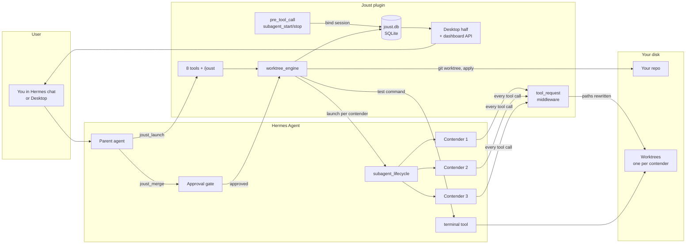

The parent agent drives everything through Joust's tools. Contender subagents never call Joust directly: their tool calls pass through the middleware, which points them at their own worktree. Every result lands in `joust.db`, which the Desktop half reads through the dashboard API.

### Who can do what

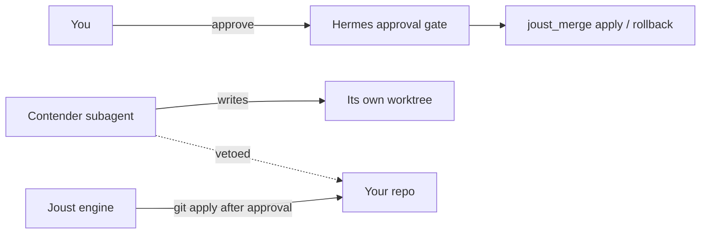

| Actor | Runs in | Can | Can never |
| --- | --- | --- | --- |
| **Contender subagent** | Hermes, its own child session | Read and write files and run commands inside its worktree | Reach your repo or a rival's worktree through file tools: the middleware redirects the path and `pre_tool_call` blocks the call |
| **Parent agent** | Your Hermes session | Launch, judge, Crossfire, report, ask to merge | Merge or roll back without your approval |
| **Joust engine** | The Hermes or plugin-host process | Create worktrees and branches in your repo, apply an approved patch | Run a model-chosen test command outside the Hermes `terminal` tool |
| **Desktop and dashboard** | Hermes Desktop, dashboard API | Read bouts, run the built-in demo, merge on your explicit click | Judge from a click: judging is handed to the agent |

### From goal to merged patch

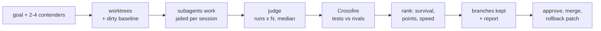

Ranking is computed the same way everywhere (`_score_rows` and `get_bout_details`): contenders that passed every run and are not flaky first, then Crossfire survival rate, then points, then speed. Contenders that have not run yet keep their `ready` or `running` status, and the bout stays `partial` until every contender has been judged.

### A live bout, end to end

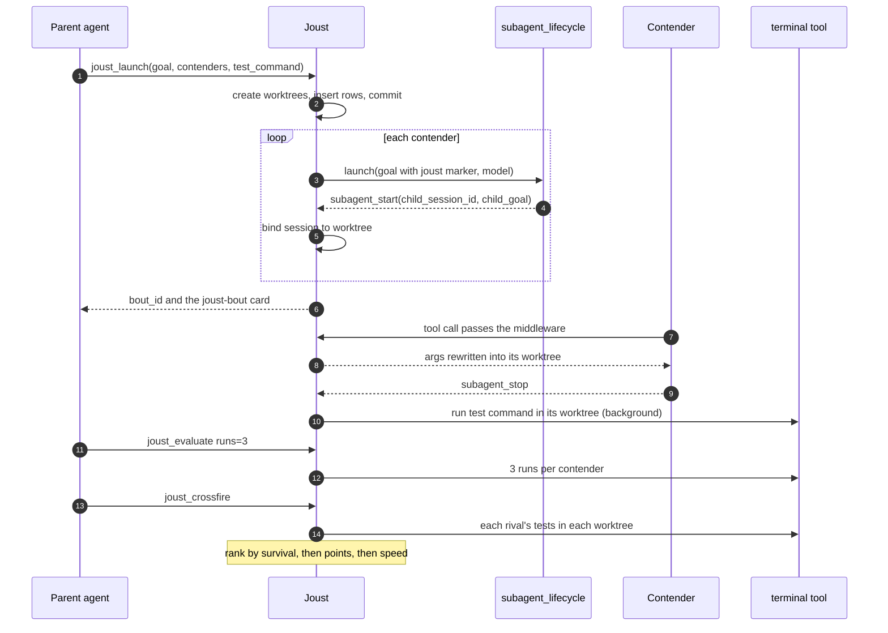

Steps 3 to 6 rely on the hook ordering in Hermes 0.23.0: `subagent_start` fires inside `launch()`, so Joust inserts the contender rows before launching and never holds its lock across the call.

### Merge with approval, then rollback

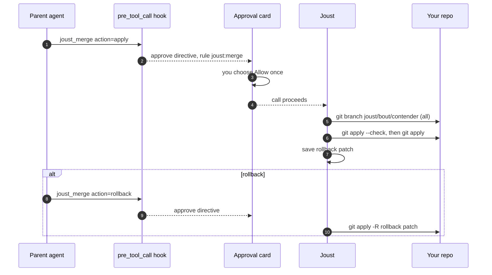

A dry run (`action="dry_run"`) is never escalated and never touches the saved rollback patch. A second apply is refused until the first is rolled back.

### An escape attempt

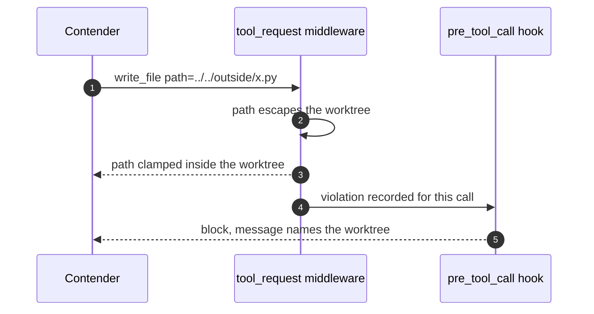

Containment is component-aware (`_inside`): a contender in `.../alpha` cannot reach a sibling `.../alpha-2`. Absolute paths into your repo are mapped to the same place inside the worktree.

### Getting set up

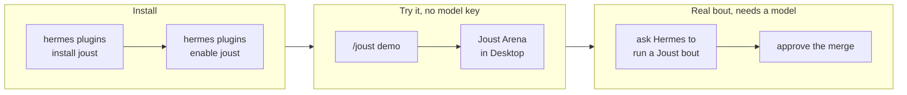

### A real bout

On Nov 8, 2026, bout `bout-18dbdfb6` ran three real subagents through Hermes Agent 0.23.0 on the order-book task the demo uses: `claude-buckets` on claude-sonnet-4.6, `gpt-bisect` on gpt-5.5 and `gemini-sweep` on gemini-3.1-pro-preview. It took 2 minutes 25 seconds from launch (12:15:11 UTC) to report. All three passed the official suite three times out of three. On points Gemini (83.1) beat GPT (81.7), but Crossfire showed Gemini's matcher drops leftover quantity when one order fills across several, which Claude's and GPT's regression tests both caught and the official suite never tested. Final ranking: Claude 91.5 (Crossfire 1 of 2), GPT 81.7 (1 of 2), Gemini 83.1 (0 of 2). The winner's median was 3.65 ms against 260 ms for the baseline. The merge and the rollback each went through Hermes's approval card.

## Safety

- **Test commands go through Hermes.** Model-chosen commands run via `ctx.dispatch_tool("terminal", ...)`, so guards, approval prompts and your terminal backend apply. If the tool refuses, the contender is recorded as failed and nothing else is tried. Without the terminal tool nothing runs: `hermes joust judge` and the dashboard refuse and point you to `/joust judge` or the agent. Only the built-in demo, whose commands Joust writes itself, uses a bounded `/bin/sh -c` subprocess.
- **Merges need you.** `joust_merge apply` and `rollback` raise the approval card. Patches are pre-flighted with `git apply --check`, a rollback patch is saved, and every contender is kept as a branch first.
- **Hard limits.** 2 to 4 contenders with unique names, timeouts clamped to 5 to 600 seconds per contender, 1 to 7 Flake Shield runs, output stored as the first 3,000 plus the last 5,000 characters, diff previews capped at 4,000 characters.
- **Isolation is scoping, not a sandbox.** File paths, patch headers, search roots and terminal working directories are redirected and escapes are vetoed, but the text of a shell command is not rewritten. Judge only code you are willing to run.
- **Secrets stay out of storage.** Captured output is scrubbed of token-like strings (API keys, GitHub and Slack tokens, AWS key ids, bearer tokens) before it is stored or shown.
- **Tested.** See the test status under Run it locally.

### Screenshots

All four were captured on Nov 8, 2026 from Hermes Agent 0.23.0's own Desktop renderer (the Webapp served by the gateway), with Joust switched on in Capabilities > Plugins, showing the real bout above.

| Joust Arena page | Inline card in chat |
| --- | --- |
|  |  |
| **Flake Shield output in the inspector** | **Joust in Hermes's Plugins tab** |
| 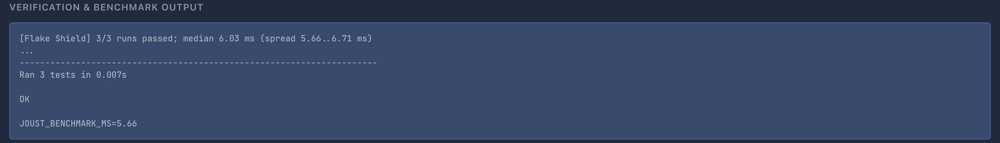 | 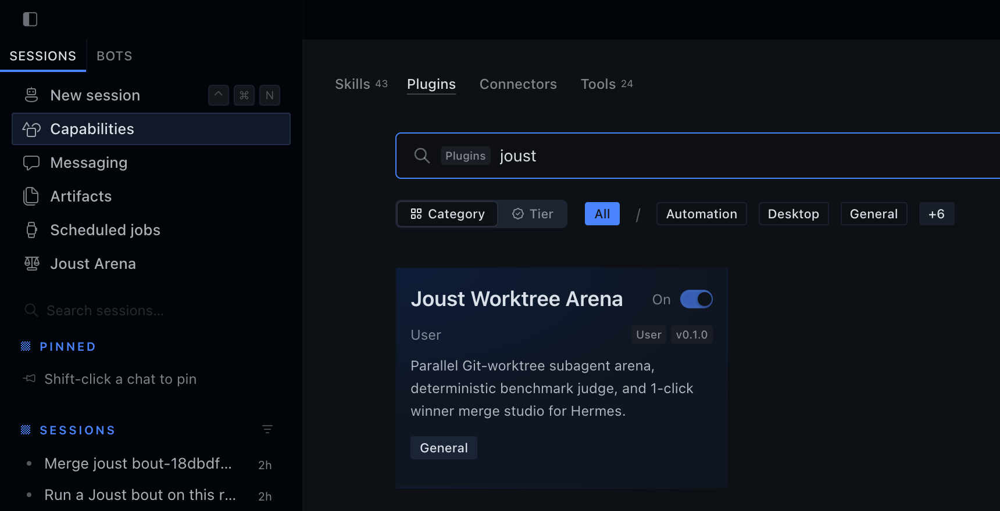 |

## What's real and what's simulated

| Real | Simulated or labelled |
| --- | --- |
| Live bouts: real Hermes subagents, real worktrees, your real test command, real Git branches, a real `git apply` | `/joust demo`: the three implementations are written by Joust, not by models. No model is called. Its `model` fields are labels only. |
| Scores, run counts, timings and Crossfire outcomes, all read from `joust.db` | Nothing else. There are no points, credits or mock UI states. |

## Tech stack

Python 3.11+ standard library only (no third-party dependencies) · Hermes Agent >= 0.22.5 public plugin APIs (`ctx.register_*`, `ctx.subagent_lifecycle`, `ctx.dispatch_tool`, `tool_request` middleware, four hooks) · SQLite (WAL) · Git >= 2.20 worktrees · Hermes Desktop plugin SDK with React · FastAPI router for the dashboard · tests with `unittest`, the desktop harness with Node, React 19 and happy-dom.

## Run it locally

**Prerequisites:** Hermes Agent 0.22.5 or newer, Git 2.20 or newer, Python 3.11 or newer. Node 20 or newer only for the desktop smoke harness.

Joust has no environment variables. Its settings live in the Hermes plugin config:

| Setting | Default | What it does |
| --- | --- | --- |
| `default_timeout_seconds` | `60` | Per-contender timeout for the test command, clamped to 5 to 600 |
| `default_runs` | `1` | Flake Shield runs when `joust_evaluate` is called without `runs` (1 to 7) |
| `auto_evaluate_on_stop` | `true` | Judge a contender automatically when its subagent finishes |
| `keep_loser_branches` | `true` | Keep every contender as a `joust/<bout>/<contender>` branch before merge or cleanup |
| `keep_backup_patches` | `true` | Save the rollback patch before applying a merge |

```bash
hermes plugins install https://github.com/mrnetwork0001/Joust
hermes plugins enable joust
hermes plugins validate /path/to/Joust --install-deps
```

```bash
python3 -m unittest discover -s tests          # plain Python: Hermes-only tests skip
python3 demo_arena.py                          # the demo tournament in a terminal
node tests/desktop_smoke/smoke.mjs             # needs react, react-dom, happy-dom outside the repo
```

**Test status (2026-11-09 08:28 UTC):**

```
python3 -m unittest discover -s tests          Ran 97 tests ... OK (skipped=16)
with Hermes 0.23.0 importable                  Ran 97 tests ... OK (skipped=1)
hermes plugins validate --install-deps .       Validation passed.  (no warnings)
node tests/desktop_smoke/smoke.mjs             [desktop-smoke] 55 passed, 0 failed, 2 warnings, 0 skipped  (2026-11-08; desktop/ unchanged since)
```

The tests with Hermes importable load Joust through the real plugin manager and drive the real `apply_tool_request_middleware`, `invoke_hook`, tool dispatch and slash dispatch, in both `plugins.isolation: in_process` and `host` modes.

## Deploying

1. **List it.** Add `plugin-catalog/joust.yaml` (draft in `catalog/joust.yaml`) to NousResearch/hermes-agent, pinned to a full 40-character commit SHA, with the disclosure below in the PR description.
2. **Install it.** Users run `hermes plugins install joust` and `hermes plugins enable joust`. Nothing else to configure.
3. **Plugin host mode.** Under `plugins.isolation: host`, everything works except the `hermes joust` CLI subcommand, which Hermes only wires in-process. Use `/joust`, the tools or Desktop instead.
4. **First live run.** See A real bout above.

## Repository map

```
Joust/
├── plugin.yaml              manifest: 8 tools, 4 hooks, 1 middleware, 5 settings
├── __init__.py              register(): tools, middleware, hooks, /joust, CLI, skill
├── arena_tools.py           tool handlers, config readers, terminal runner wiring
├── schemas.py               JSON schemas for the 8 tools
├── worktree_engine.py       Git worktrees, session binding, path jail, judging,
│                            Flake Shield, Crossfire, branches, reports, merges, demo
├── dashboard/
│   ├── manifest.json        dashboard plugin entry
│   └── plugin_api.py        FastAPI router: GET /bouts, /bouts/{id}, /bouts/{id}/diffs,
│                            POST /bouts/demo, /evaluate, /steer, /merge
├── desktop/plugin.js        Desktop page, pane, status chip, palette command, inline card
├── skills/joust-arena/      bundled skill teaching the workflow
├── demo_arena.py            terminal demo
├── catalog/joust.yaml       catalog entry draft
├── assets/                  banner and real Hermes screenshots for the catalog gallery
└── tests/                   97 unittest cases + the desktop smoke harness
```

## Disclosure (catalog rule 13)

- **Repository access and git writes.** Joust reads the Git repository given by `repo_path` (or the session's working directory) and runs local `git` in it and in its worktrees: `rev-parse`, `diff HEAD --binary`, `worktree add --detach` (this registers `<repo>/.git/worktrees/<contender>` entries that persist until `joust_merge action="cleanup"`), `worktree remove --force`, `worktree prune`, `add -N` plus `diff HEAD` on every status, listing, diff and dashboard refresh (new files are intent-added inside the worktree index only), `apply` (your uncommitted tracked edits into each worktree at launch, then the winning patch into your working tree on `joust_merge`), `apply -R` (rollback), and `init`, `add -A` and `commit` for the built-in demo repository and for the fallback used when `git worktree add` is refused. That fallback copies the repository directory, including untracked files, into the plugin data folder (ignoring `.git`, `__pycache__`, `.venv`, `node_modules`). Only tracked edits are mirrored into worktrees; untracked files are not.
- **Command execution.** The bout's test or benchmark command (chosen by you or the model) runs in every contender worktree through the Hermes `terminal` tool via `ctx.dispatch_tool`, so Hermes's dangerous-command guards, approval prompts and the configured terminal backend apply. If the terminal tool refuses or is unavailable, the contender is recorded as failed and nothing else is tried. The same path is used when a contender subagent finishes (`auto_evaluate_on_stop`, default on). Without the terminal tool the command is never run: `hermes joust judge <bout>` and the dashboard's evaluate route refuse and point you to `/joust judge <bout>` or the agent, and the engine itself refuses any call that has no terminal runner. Only the self-contained demo (`/joust demo`, `hermes joust demo`, the Desktop Run Demo button) uses a bounded `/bin/sh -c` subprocess, for the plugin-authored commands it writes into a plugin-owned temporary repository. Timeouts are clamped to 5 to 600 seconds per contender; contenders are judged sequentially.
- **Approvals.** `joust_merge apply` and `rollback` are escalated to Hermes's human approval gate through a `pre_tool_call` approve directive. The Desktop Re-Judge buttons hand the request to the agent instead of executing from an HTTP click. The Desktop Merge button is an explicit user action on a reviewed diff with a saved rollback patch.
- **Branches.** With `keep_loser_branches` (default on), `joust_merge apply` and `cleanup` and `joust_report` create `joust/<bout>/<contender>` branches in your repository from each worktree's state (including untracked files, junk excluded); delete them with `git branch -D`. `joust_crossfire` temporarily copies test files into rival worktrees under a `__xfire_` suffix and removes them afterwards. `joust_report write_path` writes a markdown file inside the repository, never under `.git/`, only when you ask for it.
- **Files written.** Worktrees under `<HERMES_HOME>/plugin-data/joust/worktrees/<bout>/<contender>`, rollback patches under `.../backups/`, temporary pre-flight patches under `.../tmp/`, reports under `.../reports/`, the demo repository under `.../demo_orderbook_repo/`, and bout metadata (goals, repository and worktree paths, test commands, captured output, diff stats, events) in `.../joust.db` (SQLite, WAL). `joust_steer(write_files=...)` writes only inside the contender's worktree.
- **Subagents and cost.** `joust_launch` starts one Hermes subagent per contender through `ctx.subagent_lifecycle` (default on); each uses tokens on the model it runs on. A `tool_request` middleware rewrites file paths, V4A patch headers, `search_files` roots and terminal `workdir` for those child sessions into their worktree; the text of shell commands is not rewritten (best-effort scoping, not a sandbox). A `pre_tool_call` hook vetoes calls whose paths point outside the worktree.
- **Desktop events.** Bout snapshots (title, goal, repository and worktree paths, scores, up to 4,000 characters of diff per contender, captured test output) are broadcast to connected Hermes Desktop windows as `plugin.joust.bout.updated`; the Desktop half also polls the dashboard API every 4 seconds while visible. Captured output is scrubbed of token-like strings with a standard-library regex before it is stored or shown.
- **Network, credentials, telemetry, dependencies.** No network calls, no credentials or `requires_env`, no telemetry or usage reporting, no third-party Python dependencies. Linux and macOS.

## Pre-existing work and credits

- **Hermes Agent** by Nous Research: the plugin APIs, subagent lifecycle, approval gate and Desktop plugin SDK Joust builds on.
- **The demo task** (an order-book matcher with a zero-quantity bug) was written for this project.
- No vendored code and no prior Joust code: everything in this repository was written for the hackathon.

## License

MIT, see [LICENSE](LICENSE).

---

Joust runs the code your contenders write. Review a diff before you approve a merge.
